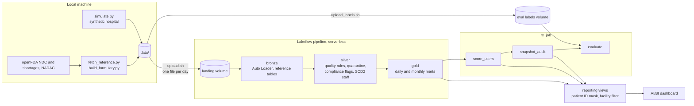

# dabs-rx: Controlled Substance Surveillance Lakehouse

> **All data in this project is synthetic.** No real patients, staff, cabinets, or hospitals are represented. Names and IDs are generated. Only the drug reference data (NDCs, DEA schedules, costs, FDA shortages) comes from public sources.

## What this models

An inpatient pharmacy has to account for every controlled substance that leaves an automated dispensing cabinet (ADC). This project builds the reporting for that job on a synthetic two-hospital system. It is a Databricks Asset Bundle that runs on Databricks Free Edition.

- **Controlled substance monitoring.** It catches count discrepancies and flags events a pharmacist should review: overrides, unwitnessed or late wastes, and pulls with no active order or after the patient left.
- **Diversion surveillance.** It compares each nurse every month with peers on the same unit and shift. It produces a ranked review list with plain-language reasons, such as "waste ratio more than 10 SD above peers (0.31 vs peer median 0.05)".
- **Inventory and shortage exposure.** It reports cabinet stock, days on hand, and pockets below their restock level. It also shows which formulary items are on the current FDA shortage list.
- **Audit trail.** Every monthly review list is saved and never changed, so anyone can see what the report showed on a past date.

Daily and monthly reports appear on an AI/BI dashboard. Scores are a screening aid for pharmacy review, not a finding of diversion.

## Architecture



## Results

How well the monthly review list finds the nurses with injected diversion-like patterns. The data covers all 180 days, 2026-03-01 to 2026-08-27. Counts are pooled over the months that have at least one injected nurse (April to August), and the numbers come from `eval.metrics`.

| Method | Top 5%: precision | Top 5%: recall | Top 10%: precision | Top 10%: recall |
|---|---|---|---|---|
| Peer-grouped (facility, unit, shift) | 0.367 (11 of 30) | 0.647 (11 of 17) | 0.200 (12 of 60) | 0.706 (12 of 17) |
| Baseline (all nurses together) | 0.233 (7 of 30) | 0.412 (7 of 17) | 0.167 (10 of 60) | 0.588 (10 of 17) |

How to read this:
- **Ceiling.** Only 2 to 4 of the 120 nurses carry an injected pattern in any month. So the best possible pooled precision is 0.57 at the top 5% (6 nurses a month) and 0.28 at the top 10% (12 nurses).
- **Why the baseline does worse.** Many of its top spots go to ED nurses. They override and waste more for ordinary reasons (doses given before pharmacist verification, partial vials), and they look normal next to other ED nurses.
- **False positives.** Most come from small numbers. One or two pulls after discharge, in a month when no peer had any, stand out sharply even though one event is weak evidence.

## Free Edition design decisions

| Constraint | What this project does |
|---|---|
| Outbound internet is limited to trusted domains | openFDA and NADAC are fetched on a local machine (`generator/`) and uploaded as files. Nothing on Databricks calls an external API. |
| One active pipeline per pipeline type | One serverless pipeline builds bronze, silver, and gold. Scoring, the audit snapshot, and evaluation run as job tasks, not as a second pipeline. |
| Serverless compute, Python and SQL only | Job tasks use serverless environments. There are no cluster specs, and no RDDs or caching. |
| One 2X-Small SQL warehouse | Dashboard datasets read small, pre-aggregated reporting views. There are no heavy joins at view time. |
| At most 5 concurrent job tasks | `rx_job` has 4 tasks that run in sequence. |
| Daily compute quota | The synthetic data is small (about 186,000 cabinet events). A full run takes about 6 minutes. |
| One workspace | `dev` and `prod` live in the same workspace. Development mode adds a `dev_<user>_` prefix to every schema. |

## Reproduce

You need Python 3.11 with `uv`, the Databricks CLI (v1.8 or later) with a profile for your workspace, and a Unity Catalog catalog. The catalog name goes in the `catalog` variable in `databricks.yml`.

```bash
uv sync && uv run pytest                          # local tests, no Databricks needed

# 1. Build data locally
uv run python -m generator.fetch_reference        # network: openFDA, NADAC
uv run python -m generator.build_formulary        # 20-item controlled substance formulary
uv run python -m generator.simulate               # 180 days of synthetic activity into data/

# 2. Deploy and load
export DATABRICKS_CONFIG_PROFILE=<profile>
databricks bundle deploy -t dev
generator/upload.sh 1 150                         # first 150 days
generator/upload_labels.sh                        # answer key, eval schema only
databricks bundle run rx_job -t dev               # pipeline, scores, snapshot, eval
databricks bundle run rx_governance_job -t dev    # access table, ID mask, reporting views

# 3. Incremental load
generator/upload.sh 151 180
databricks bundle run rx_job -t dev               # reads only the 30 new days
```

Then open the dashboard "Rx Surveillance (synthetic data)" from `databricks bundle summary -t dev`. To see patient IDs, add yourself to the workspace group `rx_privileged`.

A fixed seed makes the simulator output the same on every run. The reference fetch is the exception: openFDA and NADAC change weekly, and `data/reference/manifest.json` records which fetch was used.

## Limitations

- **Simpler than real diversion.** The injected patterns are cleaner than real diversion. Real cases are rarer and change over time, and people who divert adapt to monitoring. The precision and recall above describe this simulation, not a real hospital.
- **A screening aid.** Rules and z-scores point a pharmacist to records worth reviewing. They do not show that anyone diverted anything.
- **Small counts are noisy.** Several of the measured rates come from a handful of events a month, so a nurse can rank high from one or two events.
- **Cabinet-only stock.** Days on hand uses cabinet stock only, because central pharmacy stock is not modeled.
- **Estimated costs.** Spend uses NADAC, an outpatient retail benchmark, or a seeded fallback cost. It is not a contract price.
- **Single-user access checks.** Access controls were checked with one user by changing that user's own group membership and facility access. See `docs/design_notes.md`.

## How it works

### Reference data
| Source | Used for |
|---|---|
| openFDA NDC directory | NDC and DEA schedule for each formulary item |
| openFDA drug shortages | Which formulary items are on the current FDA shortage list |
| NADAC (CMS Medicaid) | Unit cost per tablet or mL |

The formulary has 20 controlled substances across Schedules II to V, defined in `generator/config.yaml`. For each item, the build picks one NDC from openFDA. It prefers a package with a NADAC generic price, then any NADAC price, then the lowest NDC. Items with no NADAC price get a seeded fallback cost, marked `cost_source = 'fallback'`.

### Synthetic hospital
`generator/simulate.py` writes what a hospital's systems would send to the lakehouse. It produces one CSV per day for each of four feeds:
- `adc_events`: cabinet transactions (`PULL`, `OVERRIDE`, `WASTE`, `RETURN`, `CANCEL`, `RESTOCK`, `COUNT`, `DISCREPANCY_RESOLVED`)
- `adt_events`: admit, transfer, discharge
- `order_events`: new, verified, and discontinued orders
- `staff_assignments`: each staff member's unit and shift

The simulated hospital:
- **Facilities:** `MAIN` (Med/Surg A, Med/Surg B, ED) and `COMM` (Med/Surg A, Behavioral Health)
- **Cabinets:** 8 automated dispensing cabinets
- **Staff:** 120 nurses, 10 of whom transfer once; 6 pharmacists; 6 pharmacy techs
- **Volume:** about 3,000 admissions over 180 days

**Injected patterns.** 4 nurses (3%) get one or two diversion-like patterns starting partway through the window:
- high waste ratio
- unwitnessed waste
- the same witness on most wastes
- long delay between pull and waste
- pulls with no order
- pulls after discharge or transfer
- a high cancel rate

**Benign differences** make the problem harder:
- ED nurses override and waste more for ordinary reasons.
- Night shift has more volume.
- Four high-acuity nurses pull about 1.7 times the median.

**Corrupt rows.** 0.5% of cabinet rows are deliberately broken, to test the quality checks.

The answer key (`data/labels/`) is uploaded only to the eval schema. `tests/test_label_isolation.py` fails if the pipeline, scoring, snapshot, or governance code refers to it.

### Pipeline
- **Bronze:** Auto Loader streaming tables for the four feeds, with every column kept as text, plus `_ingested_at` and `_source_file`. Reference files load as batch tables. Each run reads only new files.
- **Silver:**
  - Data quality rules run as pipeline expectations: missing IDs, negative quantities, timestamps outside the window, unknown NDC or cabinet. Failing rows go to `adc_events_quarantine` with the rule names, so none is dropped without a record.
  - Compliance flags are separate columns on valid events, because those events really happened.
  - `staff_unit_scd2` keeps each nurse's unit and shift history, so events are compared with the right peers after a transfer.
- **Gold:** `daily_discrepancies`, `daily_compliance_events`, `user_activity_monthly`, `inventory_daily`, `shortage_exposure`, `procurement_monthly`.

### Scoring, review list, and evaluation
- **`score_users`:** For each nurse and month, every measure is compared with the other nurses in the same peer group, as a leave-one-out z-score. The score adds the measures where the nurse is above peers, capping each at 4.
  - A nurse-month needs at least 20 pulls.
  - The waste measures need at least 5 wastes.
  - A baseline uses the same method without peer groups.
- **`snapshot_audit`:** Appends the top 10% of nurses each month, with reasons, to `monthly_audit_snapshot`. Rows are never changed, and `VERSION AS OF` shows any past list.
- **`evaluate`:** Loads the labels and writes precision and recall at the top 5% and 10% to `eval.metrics`.

### Governance
The dashboard reads only views in the `reporting` schema (`sql/governance/`, applied by `rx_governance_job`).
- **Patient IDs.** Patient and admission IDs are shown only to members of the workspace group `rx_privileged`. Everyone else sees a short hash.
- **Facilities.** Each view shows only the facilities listed for the reader in `reporting.user_facility_access`.
- **Per-viewer queries.** The dashboard runs queries as the viewer, so these rules apply to each person who opens it.

`docs/design_notes.md` explains why views are used rather than table-level masks, and records the access checks.

### Dashboard
`dashboards/rx_surveillance.lvdash.json` is generated by `dashboards/build_dashboard.py` and deployed by the bundle. It has three pages:
- **Daily:** discrepancies, compliance events, items below their restock level, and shortage items.
- **Monthly:** the review list with reasons, which can be downloaded as CSV or Excel; flagged events by unit; and estimated spend.
- **Data quality:** quarantined rows by rule and by day.

`docs/user_guide.md` explains the dashboard for pharmacy staff, and `docs/data_dictionary.md` lists every reporting column.

## Repository layout

| Path | Purpose |
|---|---|
| `databricks.yml` | Bundle root: variables (catalog, thresholds, scoring settings) and the `dev` and `prod` targets |
| `resources/` | Schemas, volumes, pipeline, jobs, dashboard |
| `generator/` | Local scripts: reference fetch, formulary, simulator, uploads |
| `src/pipeline/` | Bronze, silver, and gold pipeline code |
| `src/scoring/`, `src/snapshot/`, `src/eval/` | Job tasks |
| `src/governance/`, `sql/governance/` | Access table, ID mask, facility filter, reporting views |
| `dashboards/` | Dashboard builder and generated JSON |
| `docs/` | User guide, data dictionary, design notes |
| `tests/` | Local tests (`uv run pytest`) |
